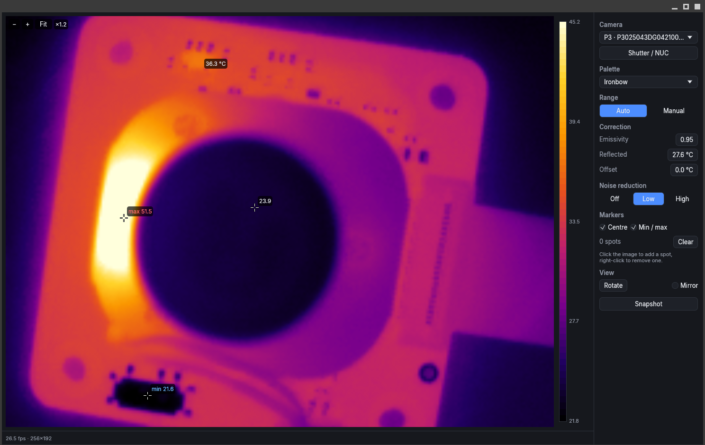

# rsttherm

<p align="center">
  
</p>

This is my attempt to get the Thermal Master P3 thermal camera running on Linux, with:

- Driver (based on [jvdillon/p3-ir-camera](https://github.com/jvdillon/p3-ir-camera); see [Credits](#credits))
- CLI and HTTP API to retrieve images programmatically
- ive viewer GUI (see [Viewer](#viewer))

## Install

```sh
make all                           # dependencies, then build and install
make install                       # build, install to ~/.local/bin and add the udev rule
make install PREFIX=/usr/local     # ... to /usr/local/bin instead
make uninstall                     # remove the binary, the udev rule and saved settings
make run                           # run the viewer from the source tree
```

Or build directly with Cargo:

```sh
cargo build --release              # CLI + HTTP + viewer
cargo build --release --no-default-features   # headless: no viewer, no display libraries
```

Installation may prompt for `sudo` access: the camera is not a webcam and does not
appear as `/dev/video*`. Accessing it over raw USB requires installing a `udev` rule
(use `make udev` to install just the rule). `make uninstall` removes the rule.

## CLI

```
rsttherm list
rsttherm [-d DEVICE] info
rsttherm [-d DEVICE] measure [-p X,Y] [-e EMISSIVITY] [--reflected °C] [--offset °C]
rsttherm [-d DEVICE] shutter
rsttherm serve [--port 8080] [--bind 127.0.0.1] [-e ...] [--reflected ...] [--offset ...]
rsttherm gui
```

`DEVICE` is a hexadecimal `VID:PID` (e.g. `3474:45a2`), or part of the serial number or model name.
If omitted, the first camera found is used.

`measure` starts the stream (about 3 s), reads one frame and prints `min`, `max`,
`mean`, `center` and optionally `point`, one per line in °C.
Pixel coordinates refer to the sensor, with `(0, 0)` at the top left.

Exit codes: `0` success, `8` invalid syntax, `16` command failed.

## HTTP API

All endpoints use `GET` and return plain-text responses. The server binds to loopback by default.

```
GET /devices
GET /measure                 # same lines as `rsttherm measure`
GET /measure?x=128&y=96      # ... plus that pixel
GET /shutter
```

Status codes: `200` success, `400` bad request, `500` failure (no frame yet, or a point outside the
image). `rsttherm gui` also serves this API, using the viewer's correction settings.

## Viewer



- Camera picker. `-d` selects the initial camera.
- Palettes: ironbow, rainbow, inferno, white hot, black hot, with a colour bar.
- Colour range: automatic (ignores the hottest and coldest), or fixed and adjusted using `Manual`.
- Markers for the centre, the hottest pixel and the coldest pixel.
- Correction: emissivity, reflected temperature, and calibration offset
- Shutter/NUC button for a flat-field calibration on demand.
- Zoom up to 8× with the mouse wheel or a pinch, around the pointer; drag to pan.
- Noise reduction (Off, Low, High) averages each pixel over several frames to reduce
  sensor flicker.
- Snapshot: the image as PNG, and the temperatures as CSV (noise reduction included), written to the working directory.

Settings and the window position are remembered across restarts.

## Android

Plug the camera into the USB-C port and Android offers to open rsttherm.

```sh
make android-tools                 # Rust targets and cargo-ndk, once
make apk                           # android/app/build/outputs/apk/debug/app-debug.apk
make apk-install                   # install it on the phone connected via adb
```

Building needs a JDK and the Android SDK with the NDK, in `~/Android/Sdk`.
Snapshots are written to `Download/rsttherm/` (Android 10 and older:
`Android/data/io.github.stroblme.rsttherm/files/`).

## Credits

The USB protocol (command bytes, the start-up sequence with its delays, frame layout
and resynchronisation) was reverse-engineered in
[p3-ir-camera](https://github.com/jvdillon/p3-ir-camera) (Apache-2.0) and the
discussion in its [issue #2](https://github.com/jvdillon/p3-ir-camera/issues/2). The
driver here is a fresh Rust implementation of that protocol.
